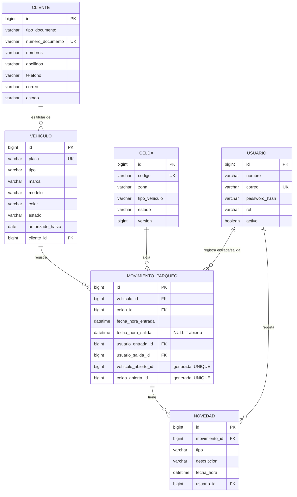

# Arquitectura y decisiones técnicas

Este documento explica **por qué** el sistema está construido así, en lenguaje de estudiante de Ingeniería de Software. Cada decisión indica qué problema resuelve y dónde está en el código.

---

## 1. Requisitos analizados y supuestos

**Actores:** ADMINISTRADOR y OPERADOR (ver tabla de permisos en `SecurityConfig.java` y en el README).

**Supuestos tomados** (donde el enunciado era ambiguo):

| # | Supuesto | Motivo |
|---|---|---|
| S1 | La mensualidad es válida **hasta el final del día** indicado en `autorizadoHasta` (inclusive). | Es lo esperado por un cliente: "pagado hasta el 30" incluye el 30. |
| S2 | Además de la vigencia, el **vehículo** y su **cliente** deben estar ACTIVOS para ingresar. | RN-03 habla de "vehículo activo"; un cliente inactivo tampoco debería ingresar. |
| S3 | Una celda solo admite su **mismo tipo** de vehículo (carro en celda de carro, moto en celda de moto). | Evita asignaciones físicas imposibles. |
| S4 | El **historial** filtra por fecha de **entrada**; `to` es inclusivo (todo ese día). Placa exacta. Máx. 500 filas. | Consulta clara y con índice; evita respuestas gigantes. |
| S5 | La **ocupación actual** filtra por coincidencia **parcial** de la placa. | En la caseta se suele recordar solo parte de la placa. |
| S6 | Permisos estrictos según el enunciado: el administrador **consulta** pero no registra entradas, salidas ni novedades; el operador no ve el historial ni administra celdas. | Separación de funciones (control interno). Se cambia en un solo archivo (`SecurityConfig`) si el negocio lo pide. |
| S7 | Se pueden registrar novedades en movimientos **abiertos o cerrados**. | Un cliente puede reportar un daño después de salir; la novedad sigue ligada a esa permanencia (RN-07). |
| S8 | Clientes, vehículos y usuarios se cargan por migración en esta iteración (no hay pantallas para crearlos). | El enunciado no los pide en la Iteración 1. |
| S9 | Las horas se registran en hora de Colombia (`America/Bogota`). | El negocio opera en Colombia; Docker suele usar UTC. |
| S10 | El administrador puede crear celdas como DISPONIBLE o FUERA_SERVICIO, nunca OCUPADA. | OCUPADA solo debe ser consecuencia de una entrada real. |

---

## 2. Arquitectura en capas (backend)

```
 HTTP ──► presentation ──► application ──► domain
                 │               │            ▲
                 │               └──► infrastructure ──► MySQL
                 └── security (filtro JWT antes de llegar al controlador)
```

| Paquete | Responsabilidad | Ejemplos | Qué NO hace |
|---|---|---|---|
| `presentation` | Traducir HTTP ⇄ casos de uso. Validar formato de entrada (`@Valid`). Convertir excepciones en respuestas JSON. | `MovimientoController`, `Solicitudes`, `GlobalExceptionHandler` | No contiene reglas de negocio ni SQL. |
| `application` | Orquestar cada caso de uso dentro de una **transacción**. | `MovimientoService.registrarEntrada()` | No conoce HTTP. |
| `domain` | Entidades y **reglas** que pertenecen a cada objeto. | `Celda.ocupar()`, `Vehiculo.validarPuedeIngresar()`, `Placa.normalizar()` | No sabe cómo se guarda nada. |
| `infrastructure` | Acceso a la base de datos con Spring Data JPA. | `CeldaRepository.findByIdForUpdate()` | No decide reglas. |
| `security` | Autenticación (JWT), contraseñas (BCrypt) y autorización por rol. | `SecurityConfig`, `TokenService`, `UsuarioActual` | — |

**¿Por qué así?** Cada cambio tiene un único lugar: una regla nueva de celdas va en `Celda`; un endpoint nuevo en un controlador; una consulta nueva en un repositorio. Además, las reglas del dominio se prueban sin base de datos (`ReglasDominioTest`) y los servicios con dobles de prueba (`MovimientoServiceTest`).

**DTOs.** Los controladores nunca devuelven entidades JPA: devuelven `record`s de `application/dto/Dtos.java`. Así no se filtran datos internos (p. ej. `passwordHash`), no fallan las relaciones *lazy* fuera de la transacción y la API puede evolucionar sin tocar las tablas.

---

## 3. Modelo de datos



Restricciones más importantes (archivo `V1__esquema_inicial.sql`):

| Restricción | Regla |
|---|---|
| `uk_vehiculo_placa` + `ck_vehiculo_placa_normalizada` | RN-01: placa única, en mayúsculas y sin espacios externos (validado también por la BD). |
| `uk_mov_vehiculo_abierto`, `uk_mov_celda_abierta` | RN-02 y RN-04 (ver sección 4). |
| `ck_mov_salida_coherente` | RN-06: fecha de salida y usuario de salida van siempre juntos. |
| `ck_mov_fechas` | La salida no puede ser anterior a la entrada. |
| `ck_novedad_descripcion` + FK `fk_novedad_movimiento` | RN-07: novedad con texto y ligada a un movimiento. |
| FKs con `ON DELETE RESTRICT` | RN-08: no se puede borrar un movimiento que tiene novedades, ni un vehículo/celda/usuario con historial. |
| `ck_*` sobre columnas de estado/tipo | Solo se admiten los valores de los `enum` de Java. |
| Índices `idx_mov_entrada`, `idx_mov_vehiculo_entrada`, `idx_celda_estado_tipo`, `idx_novedad_movimiento` | Consultas de historial, disponibilidad y novedades rápidas. |

---

## 4. ¿Cómo se garantiza "máximo un movimiento abierto por vehículo y por celda"? (RN-02, RN-04, RN-10)

Se usan **dos capas**, para no depender solo de la aplicación ni solo del navegador.

### Capa 1 — Base de datos: índice único sobre una columna generada

MySQL no tiene índices únicos *parciales* (`UNIQUE … WHERE fecha_hora_salida IS NULL`). El truco:

```sql
celda_abierta_id BIGINT GENERATED ALWAYS AS
    (CASE WHEN fecha_hora_salida IS NULL THEN celda_id END) STORED,
CONSTRAINT uk_mov_celda_abierta UNIQUE (celda_abierta_id)
```

- Movimiento **abierto** → la columna vale el id de la celda.
- Movimiento **cerrado** → la columna vale `NULL`.
- Un índice `UNIQUE` en MySQL **permite muchos `NULL`** pero no dos valores iguales.

Resultado: la celda puede tener miles de movimientos cerrados, pero si alguien intenta insertar un segundo movimiento abierto, MySQL responde `Duplicate entry` y la operación falla, **sin importar qué programa lo intente**. Lo mismo para el vehículo (`vehiculo_abierto_id`). Comprobado en `docs/evidencias/evidencia-restricciones-mysql.txt`.

### Capa 2 — Transacción con bloqueo pesimista (`SELECT … FOR UPDATE`)

`MovimientoService.registrarEntrada()` está anotado con `@Transactional` y:

1. Bloquea la fila del **vehículo** (`findByPlacaForUpdate`).
2. Verifica que no tenga un movimiento abierto.
3. Bloquea la fila de la **celda** (`findByIdForUpdate`).
4. `celda.ocupar()` valida estado y tipo y la marca OCUPADA.
5. Inserta el movimiento con `saveAndFlush` (el `INSERT` va a MySQL de inmediato, dentro de la transacción).
6. Al terminar el método se hace `COMMIT`; si algo lanza excepción, `ROLLBACK` de todo.

Si dos operadores eligen la misma celda al mismo tiempo, el segundo **espera** en el paso 3 hasta que el primero confirme; entonces lee la celda ya OCUPADA y recibe `409 CELDA_OCUPADA`. Sin el bloqueo, ambos podrían leer "DISPONIBLE" a la vez (condición de carrera). Si por cualquier motivo la capa 2 fallara (datos manipulados a mano, otro programa), la capa 1 lo detiene y el `GlobalExceptionHandler` responde `409 CONFLICTO_DATOS`.

**Salida (RN-05):** `registrarSalida()` bloquea el movimiento y la celda, cierra el movimiento, libera la celda y hace `flush` — todo en **una** transacción. La prueba `falloIntermedioHaceRollback` fuerza un error después de esos pasos y verifica que el movimiento sigue abierto y la celda ocupada.

**Edición de celdas (RN-09 + RN-10):** `CeldaService.actualizar()` también bloquea la fila, para que el administrador no pueda poner fuera de servicio una celda en el mismo instante en que se está ocupando. Además, `@Version` en `Celda` evita que dos administradores se sobrescriban (bloqueo optimista).

**Orden de bloqueo:** siempre vehículo → celda (entrada) y movimiento → celda (salida). Mantener un orden consistente reduce el riesgo de interbloqueos (*deadlocks*); si MySQL detecta uno, la excepción se traduce en `409` y el usuario puede reintentar.

---

## 5. Seguridad

| Decisión | Por qué |
|---|---|
| **BCrypt** para contraseñas | Es lento a propósito y agrega *sal*: aunque roben la BD, no se pueden recuperar las claves. |
| **JWT firmado (HS256)** en la cabecera `Authorization: Bearer …` | El servidor no guarda sesiones (*stateless*): escala mejor y es simple de probar. El token incluye id, nombre y rol, y expira (8 h por defecto). |
| **El usuario sale del token**, nunca del cuerpo de la petición | Evita que alguien registre movimientos a nombre de otro (RN-06). `UsuarioActual.id()` + prueba `usuarioSaleDelToken`. |
| Permisos por URL y método en `SecurityConfig` + `denyAll` para lo no listado | Todas las reglas en un solo lugar; lo que no está permitido explícitamente, se niega. |
| CSRF desactivado | CSRF ataca sesiones con cookies; aquí no hay cookies de sesión, el token va en una cabecera. |
| Mensaje genérico en login fallido y comparación contra un hash de relleno | No revela si el correo existe. |
| El frontend oculta opciones según el rol | Solo comodidad visual: la seguridad real la aplica el backend (403). |
| Token en `sessionStorage` | Se borra al cerrar la pestaña; adecuado para un equipo compartido en la caseta. |
| Secretos por variables de entorno (`.env` en `.gitignore`) | Nunca se suben al repositorio. |

---

## 6. Fechas y zona horaria

- El backend calcula la hora con un `Clock` en `America/Bogota` (`ClockConfig`), no con la hora del servidor (Docker suele estar en UTC).
- Se guarda como `LocalDateTime` en columnas `DATETIME(6)` (hora "de pared" de Colombia). La URL JDBC no fija `serverTimezone`, así el driver no convierte la hora entre zonas.
- Colombia no tiene horario de verano, por eso MySQL usa `--default-time-zone=-05:00` (afecta solo a `NOW()` en los datos demo).
- Las pruebas unitarias usan un reloj fijo → resultados repetibles.

---

## 7. Frontend

- **Por funcionalidades** (`src/features/<pantalla>`), con piezas reutilizables en `src/components` (diálogo de confirmación, alertas, estados de carga/vacío, ficha del vehículo, buscador de placa).
- **Un solo cliente HTTP** (`src/api/client.ts`) que agrega el token, traduce errores del backend a mensajes en español y cierra la sesión ante un `401`.
- **Todas las URLs en un solo archivo** (`src/api/endpoints.ts`) y **tipos** que reflejan los DTOs (`src/api/types.ts`).
- Estados de **carga, vacío, éxito y error** en cada pantalla; **confirmación** antes de entrada, salida y cambios de estado de celdas.
- Accesibilidad básica: etiquetas en todos los campos, `role="dialog"` con foco y tecla Escape, `aria-live` en mensajes, enlace "Saltar al contenido", contraste suficiente y diseño responsive (menú lateral plegable en móvil).

---

## 8. Cómo crecer (próximas iteraciones)

- **Pagos y facturación:** nuevas entidades `Mensualidad`/`Pago` ligadas a `Cliente`/`Vehiculo`; un servicio de pagos actualizaría `autorizadoHasta`. No requiere cambiar el flujo de entradas/salidas: este ya consulta la vigencia en un solo método (`Vehiculo.motivoRechazoIngreso`).
- **Gestión de clientes, vehículos y usuarios** desde la interfaz: nuevos controladores/servicios siguiendo el mismo patrón.
- **Auditoría:** el endpoint `/api/auth/logout` y el `GlobalExceptionHandler` son puntos naturales para registrar eventos.
- **Endurecimiento de RN-08:** en producción, el usuario de la aplicación en MySQL puede quedar sin privilegio `DELETE` sobre `movimiento_parqueo` (`REVOKE DELETE ON autos_colombia.movimiento_parqueo FROM 'autos'@'%';`).
